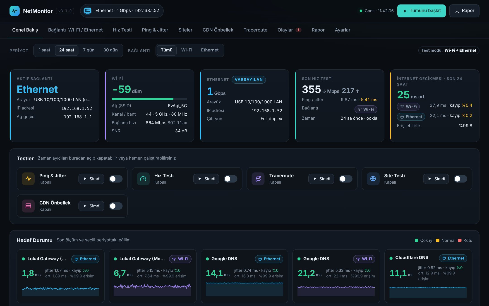
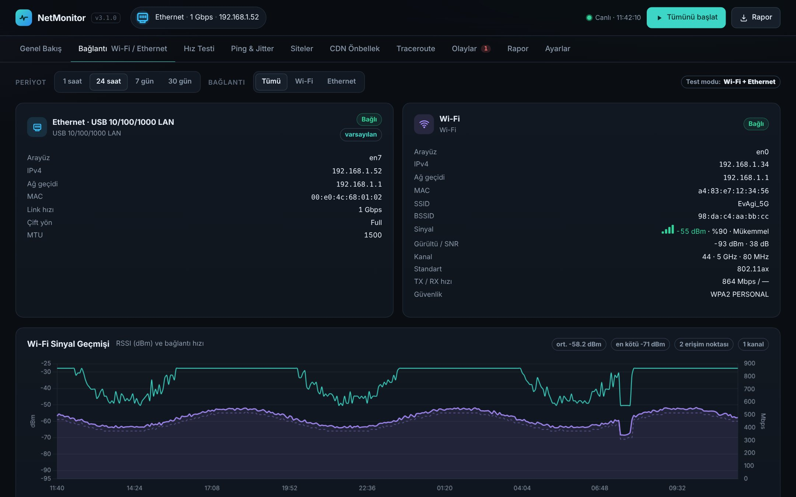
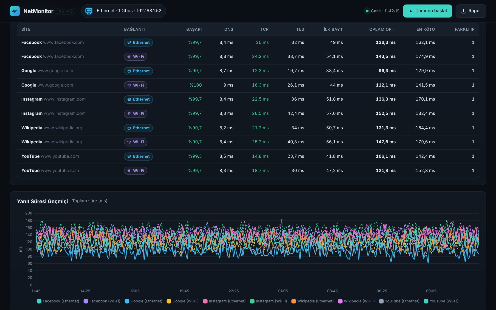
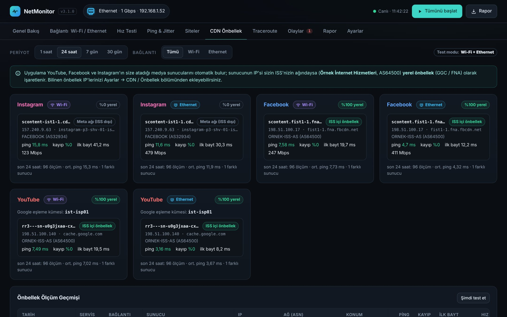
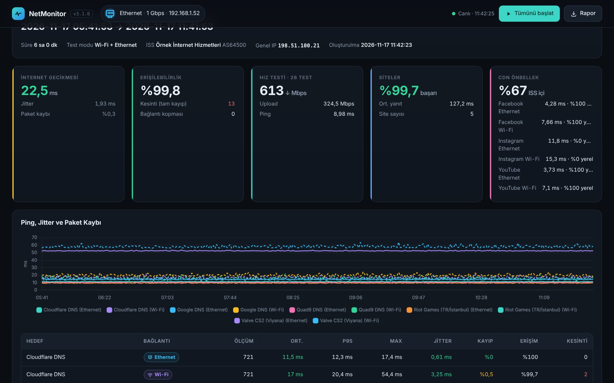

# NetMonitor — Ağ Kalitesi Sürekli İzleme




Ping/jitter/paket kaybı, hız testi (Ookla + kotasız Cloudflare) ve traceroute ölçümlerini
sürekli kaydeden; **Wi-Fi ve Ethernet bağlantılarını ayrı ayrı izleyip karşılaştırabilen**
yerel web paneli. Windows, macOS ve Linux'ta çalışır.

## Kurulum (tek komut)

**macOS / Linux** — Terminal'e yapıştırın:
```
curl -fsSL https://raw.githubusercontent.com/ferhatgunuc/netmonitor/main/install.sh | bash
```
**Windows** — PowerShell'e yapıştırın:
```
irm https://raw.githubusercontent.com/ferhatgunuc/netmonitor/main/install.ps1 | iex
```
Uygulama `~/netmonitor` (Windows: `%USERPROFILE%\netmonitor`) klasörüne kurulur ve açılır. Aynı komut
mevcut kurulumu ayarları ve verileri koruyarak günceller. Kurulumdan sonraki güncellemeler uygulamanın
içinden yapılır (Ayarlar → Güncelleme).

Elle kurulum: [Releases](https://github.com/ferhatgunuc/netmonitor/releases/latest) sayfasından
`netmonitor.zip` dosyasını indirip açın ve aşağıdaki başlatıcıyı çalıştırın.

## Hızlı başlangıç

| Platform | Çalıştırma |
|---|---|
| **Windows** | `baslat.bat` dosyasına çift tıklayın |
| **macOS** | `baslat.command` dosyasına çift tıklayın (ilk seferde: sağ tık → **Aç**) |
| **Linux** | `./baslat.sh` |

İlk çalıştırmada `.venv` sanal ortamı oluşturulur ve paketler otomatik kurulur.
Panel tarayıcıda `http://localhost:8000` adresinde açılır.

```
python main.py                  # yalnızca bu bilgisayardan erişim
python main.py --lan            # telefondan / ağdaki diğer cihazlardan erişim (0.0.0.0)
python main.py --port 8080 --no-browser
```

> Güvenlik: Varsayılan olarak yalnızca `127.0.0.1` dinlenir (eski sürüm herkese açıktı ve SMTP
> şifresini API'den döndürüyordu). Ağdan erişim gerekiyorsa `--lan` kullanın.

### Ookla CLI (isteğe bağlı)
Kurulu değilse hız testi otomatik olarak Cloudflare ile yapılır.

- Windows: `winget install Ookla.Speedtest.CLI`
- macOS: `brew tap teamookla/speedtest && brew install speedtest`
  (Homebrew'daki `speedtest-cli` farklı bir programdır, onu kurmayın.)

## Ekran görüntüleri

| Wi-Fi / Ethernet karşılaştırma | Site testleri | CDN önbellek | Oturum raporu |
|---|---|---|---|
|  |  |  |  |

## v3.1 yenilikleri
- **Siteler için traceroute:** Ayarlar → Siteler listesinde her sitenin yanında traceroute anahtarı var (varsayılan açık); periyodik traceroute bu siteleri de izler. Siteler ve Traceroute sekmelerinde girilen alan adı için anında traceroute çalıştırılabilir.
- **Geçmiş verileri temizleme:** Ayarlar → Veri Yönetimi. Veri türü seçilerek belirli gün sayısından eski kayıtlar veya tüm geçmiş silinir. Silmeden önce veritabanının yedeği `backups/` klasörüne otomatik alınır (son 5 yedek); ayarlar ve hedefler etkilenmez.

## v3 yenilikleri

### Site testi (alan adı ile)
**Siteler** sekmesinde alan adını (ör. `youtube.com` veya `https://www.wikipedia.org`) yazıp **Test et**'e basın:
- Alan adı otomatik çözümlenir: **işletim sistemi**, **ISS DNS'i** (sistemde tanımlı sunucuya önbelleksiz sorgu),
  **Google 8.8.8.8** ve **Cloudflare 1.1.1.1** yan yana; süreler ve dönen IP'ler karşılaştırılır.
- Bağlantı aşamaları ölçülür: DNS → TCP → TLS → ilk bayt (TTFB) → toplam; HTTP kodu, CDN (Cloudflare,
  Akamai, Fastly, Google, Meta…), IP'nin sahibi (ASN) ve ters DNS adı gösterilir.
- **+ Listeye ekle** ile site periyodik test listesine eklenir (Ayarlar → Siteler).

### Ookla sunucu seçimi
Ayarlar → **Ookla Sunucuları**: operatör adı, şehir veya sunucu ID ile arayın, istediğiniz sunucuları ekleyin.
Seçilen her sunucuda ayrı hız testi yapılır; rapor sunucu bazında özet verir. (Ookla CLI gerekir.)

### CDN / önbellek sunucuları (YouTube, Facebook, Instagram)
- **YouTube:** size atanan video sunucusu (`rr…---sn-….googlevideo.com`) ve Google eşleme kümesi bulunur.
- **Facebook / Instagram:** sayfalardaki medya sunucuları (`scontent….fna.fbcdn.net` vb.) bulunur.
- Sunucu IP'si kendi ISS'nizin ağındaysa (ASN eşleşmesi) **ISS içi önbellek (GGC / FNA)** olarak işaretlenir;
  ping, kayıp, ilk bayt ve (medya dosyalarında) indirme hızı ölçülür.
- Bildiğiniz GGC/FNA IP'lerini Ayarlar → CDN / Önbellek'e elle ekleyebilirsiniz.
- Otomatik keşif YouTube/Meta sayfa yapısına dayanır; bulunamazsa genel uç sunucular ölçülür ve not düşülür.

### Tümünü durdur → otomatik rapor
Üst çubuktaki **Tümünü başlat / Tümünü durdur** düğmesi tüm testleri birlikte yönetir. Durdurunca çalışan
ölçümler kesilir ve başlatmadan durdurmaya kadarki oturumun **raporu** otomatik açılır (özet kartlar, ping
tablosu ve grafiği, sunucu bazında hız testleri, site ve CDN sonuçları, bağlantı olayları). Rapor PDF,
Excel ve CSV olarak indirilebilir.

### İnternetten güncelleme
Ayarlar → **Güncelleme**: kaynak olarak GitHub deposu (`kullanici/depo`, Releases) veya kendi sunucunuzdaki
`version.json` adresi girilir. Açılışta ve 12 saatte bir kontrol edilir; yeni sürüm varsa üst çubukta rozet
çıkar, **Güncelle** ile indirilir, SHA-256 ile doğrulanır, kurulur ve uygulama yeniden başlar.
Ayarlar, veritabanı ve `.venv` korunur; eski sürüm `.backup/` klasörüne yedeklenir.

Yeni sürüm yayınlamak:
```
# main.py içinde VERSION'ı artırın, sonra:
python tools/release.py "Değişiklik notları"
gh release create v3.0.1 dist/netmonitor-3.0.1.zip dist/netmonitor-3.0.1.zip.sha256 --notes "…"
```
GitHub kullanmıyorsanız `dist/` içindeki zip'i ve `version.json`'ı (içindeki `url`'yi düzenleyerek) bir web
sunucusuna koyup Ayarlar'da o `version.json` adresini girin.

> Not: v2'den v3'e geçiş elle yapılır (v2'de güncelleyici yoktu). v3'ten sonraki sürümler uygulama içinden güncellenir.

## Wi-Fi / Ethernet özellikleri

- **Bağlantı algılama:** Tüm fiziksel arayüzler, IP, ağ geçidi, MAC, link hızı, duplex.
- **Wi-Fi detayları:** SSID, BSSID, RSSI (dBm), gürültü/SNR, sinyal %, kanal, bant (2.4/5/6 GHz),
  kanal genişliği, Wi-Fi standardı (802.11ax vb.), TX/RX hızı, güvenlik.
- **Test bağlantısı seçimi** (Ayarlar → Test Bağlantısı):
  - *Otomatik* — sistemin varsayılan bağlantısı; sonuçlar Wi-Fi/Ethernet olarak etiketlenir
  - *Yalnızca Wi-Fi* / *Yalnızca Ethernet* — kablo takılı olsa bile testler seçilen arayüze zorlanır
  - *İkisi birden* — her ölçüm iki bağlantı üzerinden eşzamanlı yapılır → **Bağlantı** sekmesinde yan yana karşılaştırma
- **Wi-Fi sinyal geçmişi** grafiği (RSSI + bağlantı hızı).
- **Bağlantı olayları:** kopma/yeniden bağlanma, varsayılan bağlantı değişimi, Wi-Fi ağı değişimi,
  erişim noktası değişimi (roaming), kanal değişimi, zayıf sinyal, Ethernet link hızı düşmesi.
- E-posta uyarıları: paket kaybı, bağlantı kopması, zayıf Wi-Fi.

| | Ping | Traceroute | Ookla | Cloudflare |
|---|---|---|---|---|
| Windows | `-S <kaynak IP>` | sistem rotası* | `--ip` | kaynak IP bind |
| macOS | `-b <arayüz>` | `-i <arayüz>` | `--interface` | `IP_BOUND_IF` |
| Linux | `-I <arayüz>` | `-i <arayüz>` | `--interface` | `SO_BINDTODEVICE` |

\* Windows `tracert` kaynak arayüz seçemez; traceroute varsayılan bağlantı üzerinden yapılır.

### SSID görünmüyorsa
Yeni işletim sistemleri Wi-Fi ağ adını konum izni olmadan gizler (sinyal/kanal yine görünür).
- **Windows 11:** Ayarlar → Gizlilik ve güvenlik → Konum → *Konum hizmetleri* ve *Masaüstü uygulamalarının konuma erişmesine izin ver* açık olmalı.
- **macOS 14.4+ / 15:** Sistem Ayarları → Gizlilik ve Güvenlik → Konum Servisleri → Terminal (veya NetMonitor) açık olmalı.

## macOS

- `baslat.command` — çift tıklayarak çalıştırma.
- `macos/build_app.sh --install` — `~/Applications/NetMonitor.app` oluşturur (Dock/Launchpad'den açılır;
  veriler `~/Library/Application Support/NetMonitor`, log `~/Library/Logs/NetMonitor.log`).
- `macos/oturum_acilisinda_baslat.sh` — Mac açılınca arka planda otomatik başlatır (`--kaldir` ile kaldırılır).
- macOS'a özel düzeltmeler: `ping -W` artık milisaniye olarak veriliyor (eski kodda 1 ms zaman aşımı
  vardı, paketler kayıp sayılıyordu); ağ geçidi `route get default` ile bulunuyor (eski kod Linux'un
  `ip route` komutunu kullanıyordu ve her zaman 192.168.1.1 varsayıyordu); `airport` komutu kaldırıldığı
  için Wi-Fi bilgisi CoreWLAN → `system_profiler` üzerinden okunuyor.

## Diğer iyileştirmeler

- Ayarlar `config.json` dosyasında saklanır — uygulama yeniden başlayınca kaybolmaz.
- Hedefler arayüzden eklenip çıkarılabilir; `@gateway` her bağlantının kendi modemini ifade eder.
- Haftalık/aylık görünümde veriler sunucuda özetlenir (eskiden yüz binlerce satır tarayıcıya gidiyordu).
- İstatistikler: ortalama, P95, min/max, jitter, kayıp, erişilebilirlik %, kesinti sayısı.
- Türkçe Windows'ta ping süresi (`süre=12ms`) artık doğru okunuyor; kayıp oranı dil bağımsız hesaplanıyor.
- Cloudflare hız testi: çoklu paralel bağlantı, ısınmış bağlantıda gecikme ölçümü (TLS el sıkışması hariç), veri sınırı ayarı.
- Traceroute atlama atlama tabloya dökülür; ham çıktı da saklanır.
- Chart.js yerel olarak gömülü — internet kesikken de panel açılır.
- Excel raporu: Özet, Hız Testleri, Ping, Traceroute, Wi-Fi Sinyal, Bağlantı Olayları sayfaları.
- PDF raporu: Rapor → PDF (tarayıcının "PDF olarak kaydet" seçeneği; vektörel, net çıktı).
- Eski `network_monitor.db` dosyası bu klasöre kopyalanırsa otomatik yükseltilir, veriler korunur.

## Dosyalar

```
main.py        FastAPI sunucu, zamanlayıcı, API, raporlar
netinfo.py     Wi-Fi/Ethernet algılama (Windows / macOS / Linux)
probes.py      ping, traceroute, hız testi (arayüze bağlama), Ookla sunucu arama
webprobe.py    DNS çözümleme, site zamanlaması, ASN, CDN/önbellek keşfi
updater.py     internetten güncelleme
tools/         release.py — güncelleme paketi hazırlama
docs/          tanıtım sayfası (GitHub Pages) ve ekran görüntüleri
storage.py     SQLite şema, göç ve sorgular
static/        arayüz (index.html, app.css, app.js, vendor/chart.umd.js)
macos/         .app oluşturucu ve otomatik başlatma
```
